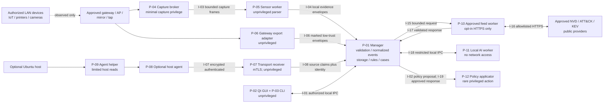

<!--
SPDX-FileCopyrightText: 2026 Chris Sutton
SPDX-License-Identifier: MIT
-->

# KnetSentry — Modular System Architecture

**Issue:** M0.4 / GitHub #4. **State:** design contract; no software, sockets,
firewall policies, or isolation mechanisms are implemented by this change.
**Target:** Ubuntu 26.04 LTS AMD64; Qt 6/Kirigami GNOME- and Plasma-compatible GUI.
**Authoritative upstream contracts:** [product scope](PRODUCT_SCOPE.md),
[network policy](../security/NETWORK_SCOPE_REQUIREMENTS.md), and
[M0.3 threat model](../security/THREAT_MODEL.md).
**Architecture companions:** [component catalog](COMPONENT_CATALOG.md),
[interface contracts](INTERFACE_CONTRACTS.md),
[deployment topologies](DEPLOYMENT_TOPOLOGIES.md),
[security traceability](ARCHITECTURE_TRACEABILITY.md), and
[architecture decisions](adr/0001-security-process-boundaries.md).

## 1. Architectural objectives and non-objectives

- **First-class agentless monitoring:** an authorized mirror/tap/gateway/export
  can produce actionable security telemetry from printers, doorbells and other
  LAN devices with **no KnetSentry software on those devices**. Optional host
  agents add visibility, never gate network-event ingestion or alerts.
- **Three independently authorized activities:** observing a designated LAN
  sensor domain; authenticated local collection/control transport; opt-in
  manager-originated approved public threat-intelligence HTTPS. Observing an
  external peer never grants authority to probe it.
- **Separate execution authority:** no GUI root access; untrusted packet
  parsing outside the privileged capture broker; manager without packet
  capture or firewall-modification capabilities; feed/AI workers without
  database/administrative write access.
- **Preserve uncertainty:** source authentication, data authenticity, device
  attribution and coverage are distinct properties. No data == no visibility,
  not a clean bill of health; TLS and hashes do not validate source claims.
- **Offline core:** collection, rules, storage, cases, and GUI work without
  external Internet or AI; intelligence sync and offline model analysis are
  optional and resource-bounded.
- **No early implementation claims:** concrete wire encoding, numeric port
  allocations, parser/capture library, SQL schema, and exact sandbox profiles
  are deliberately deferred to owner issues and tested decisions.

## 2. Logical data flows and operating-system processes

The arrow `D -> X` is **observation**, not active control of device D.
Gateway sources may emit syslog, DHCP/DNS, or flow records but cannot be
assumed to provide cryptographic sender authenticity. The diagram simplifies
some flow validation steps; [interface contracts](INTERFACE_CONTRACTS.md)
are normative for the proposed message boundaries.

**Process baseline:** manager, Qt GUI, CLI, capture broker, sensor parser,
gateway adapter, agent, optional agent helper, transport receiver, feed worker,
AI worker, and policy applicator are distinct process roles (`P-01`–`P-12`).
Not every role is necessarily running on a given installation. C++ event
normalization, event storage, rules, asset relationships, and cases are
initially in-process manager modules with separate internal interfaces.
Security review may further subdivide processes; combining the privileged
capture broker with packet parsing, or combining the Internet feed worker with
AI, is **not permitted** without an explicit revised threat assessment.

## 3. Trust boundaries and enforcement placement

The [M0.3 trust boundaries](../security/THREAT_MODEL.md) remain authoritative.
Each `TB-01`–`TB-12` is assigned a primary owner, a validated handoff, and a
planned independent check in [security traceability](ARCHITECTURE_TRACEABILITY.md).

- **Scope authorization** lives in the manager policy subsystem (`C-02`),
  with separate kernel/host enforcement managed by a narrow policy applicator
  (`C-21`). Host policy is not assumed active until verified; failure leaves
  the affected operation denied. No report from a sensor may change policy.
- **Capture privilege** belongs solely to `P-04`. It applies pre-approved
  interfaces and capture filters before passing bounded data to `P-05`.
  Packet parsing/normalization has no ambient capture or root privilege.
- **Agent/gateway trust** is asymmetric. Optional agents use explicit
  enrollment and authenticated transport. Gateway feeds get per-source
  provenance and a declared authentication strength, possibly *unverified*.
- **Remote Internet access** is a separate, opt-in `P-10` operation with
  provider restrictions, validated TLS, response limits, request auditing,
  and no arbitrary URL construction from observed event content.
- **Response and export authority** can only originate from an authenticated,
  action-authorized local user and an independently approved action scope.
  Detection output, feed content and AI are suggestions/data, not principals.

## 4. Data-plane ownership and event lifecycle

1. `C-05/C-06` (agentless capture), `C-07` (gateway adapters), or `C-08`
   (optional agent) produce a **source evidence envelope**. Remote sensors
   may reuse the `C-10` authenticated receiver with sensor-specific identities
   and permissions; a sensor does **not** become an endpoint agent.
2. `C-11` validates transport identity separately from source claims, approved
   monitoring scope, version, size, timestamps, and duplicate identifiers.
   Quarantine/reject reasons and source-health status are retained where
   permitted. Invalid or unauthorized data never proceeds as trusted evidence.
3. `C-12` normalizes a pinned OCSF-aligned supported subset while preserving
   original source bytes *where configured*, event/receive timestamps,
   collection path, identity confidence, and known observation limitations.
4. `C-13` writes accepted events and metadata transactionally, applying quotas
   and migrations; original records are separate from analyst annotations.
   Integrity digests detect subsequent changes, not source truthfulness.
5. `C-14` deterministically evaluates rule fixtures and produces evidence-
   referenced findings; `C-15` correlates tentative assets and coverage
   without falsely merging devices on IP/MAC alone.
6. `C-16` manages cases, exports and explicitly approved response requests.
   `C-19` records administrative actions and source-health degradation.
7. `C-03/C-20` presents authorized bounded/paginated results via Qt models.
   QML never receives raw keys, privileged file descriptors, or direct SQL.

**Key schema concepts, not a frozen serialization:** `EventId`, `SourceId`,
`ObservationScopeId`, `MonitoredAssetRef?`, `ExternalPeer?`, `EventTime?`,
`AcquisitionTime`, `ManagerReceiveTime`, `SourceTrustClass`,
`AttributionConfidence`, `CoverageState`, `EvidenceReference`, `SchemaVersion`,
`ProcessingDisposition`. Unknown or absent values are represented explicitly,
not filled in with fabricated defaults. Binary parser and network limits are
set by M3–M6 and initial engineering workload budgets by
[M0.5 requirements](../development/PERFORMANCE_REQUIREMENTS.md). These
targets are unmeasured until M14 qualification.

### Storage placement and raw-first durability

The [administrator-selectable storage contract](STORAGE_PLACEMENT_CONTRACT.md)
requires permitted original event records to be durably written to a configured
local volume **before** normalization and indexed storage. The raw store and
SQLite index store can reside on separate mounted local drives. The GUI only
proposes a folder; the manager alone authorizes its storage configuration.
On a missing/replaced drive, no writing into the vacated mount path on the OS
filesystem is allowed. A raw-durable event is not automatically indexed.

## 5. Dependencies, storage and interface governance

[Component catalog](COMPONENT_CATALOG.md) enumerates roles `C-01`–`C-21`,
processes `P-01`–`P-12`, allowed dependencies and prohibited privilege edges.
[Interface contracts](INTERFACE_CONTRACTS.md) enumerate `I-01`–`I-23` and
cross-boundary requirements for authentication, size limits, error handling,
retry/idempotence and audit. Interfaces are **logical designs**, not active
sockets, bindings, or compiled classes.

- Storage is initially SQLite-backed through `C-13` behind a testable C++
  repository abstraction; storage itself has no network listener. Access is
  manager-mediated; single-writer and read-query isolation choices are
  implementation details for M6/M14 measurement.
- `C-14` deterministic detection is independent of `C-18` local AI. No rule,
  incident, or case path may require model availability.
- Qt 6/Qt Quick/QML + KDE Frameworks 6/Kirigami belong to the desktop
  process only. `C-20` uses typed, paginated Qt models and IPC; all security
  logic remains in C++ services. KDE Plasma is not required on GNOME.
- Protocol format, external dependency licensing, API versions and encryption
  at rest are open decisions with assigned milestones, **not** implicit
  promises in this architecture issue.

## 6. Architectural guardrails and change management

A proposed change that adds a listener, changes OS privileges, introduces an
Internet destination, processes raw packets, changes data retention, grants
administrative authority, or moves a component across a trust boundary MUST
update the relevant M0.3 threat row, this architecture, and a negative test
plan before implementation acceptance. Architectural review will distinguish
performance optimization from safe removal of a security boundary.

Implementation ownership: M1 (build/GUI), M2 (manager/IPC/systemd), M3 plus
proposed M3.9 (scope, host enforcement/feed egress), M4 (agent transport and
PKI), M5 plus proposed M5.10 (collectors/agentless), M6 (storage/pipeline),
M7 plus proposed M7.10 (deterministic agentless detections), M8–M11
(SOC/assets/cases/approved responses), M10.9 (feed sync), M12 (optional AI),
M13 (adversarial controls), M14–M15 (reliability, packages). These proposed
issue additions must be confirmed against the actual GitHub roadmap before
being considered assigned work.
