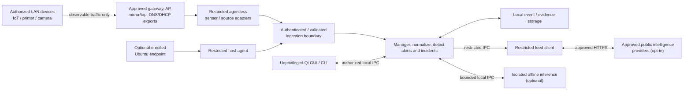

<!--
SPDX-FileCopyrightText: 2026 Chris Sutton
SPDX-License-Identifier: MIT
-->

# KnetSentry — Initial Threat Model

**Issue:** M0.3 / GitHub #3
**Status:** Design-stage assessment, not deployed protections or a penetration-test report.
**Scope:** Proposed Ubuntu 26.04 AMD64 manager, Qt 6 desktop, agentless sensors,
optional agents, local storage/detection/incident handling, and opt-in external
intelligence/AI capabilities.
**Companion documents:** [threat register](THREAT_REGISTER.md),
[verification and ownership matrix](THREAT_VERIFICATION_MATRIX.md),
[network requirements](NETWORK_SCOPE_REQUIREMENTS.md),
[network verification plan](NETWORK_SCOPE_VERIFICATION_PLAN.md), and
[network communication matrix](../architecture/NETWORK_COMMUNICATION_MATRIX.md).

## 1. Purpose, method, and rules of interpretation

This model asks: **What are we building; what can go wrong; what must we do;
and how will we know it works?** It uses a proposed data-flow architecture,
trust-boundary analysis, **STRIDE** categories, and an explicitly qualitative
risk screen. Additional privacy, availability, supply-chain, detection-evasion,
and AI misuse cases are included where STRIDE alone is insufficient.

It concerns **two distinct security subjects**:

1. **Protecting KnetSentry and its users:** Prevent unauthorized collection,
   identity spoofing, privilege escalation, compromised feeds, exfiltration,
   tampered evidence, unsafe responses, and denial of service against the SIEM.
2. **Recognizing activity on the monitored LAN:** Interpret observable events
   involving authorized local devices, including agentless printers, cameras,
   and doorbells. Observing suspicious activity does **not** prove compromise,
   establish causation, guarantee detection, or grant permission to probe an
   unrelated Internet peer.

The [M0.4 architecture](../architecture/SYSTEM_ARCHITECTURE.md) resolves
proposed process and interface ownership; its
[security traceability matrix](../architecture/ARCHITECTURE_TRACEABILITY.md)
assigns `TB-01`–`TB-12` and `TH-001`–`TH-042` to logical components. This
remains a design, not evidence of effective controls.

All controls in these documents are **requirements or future mitigations**, not
implemented or verified protections. The initial risk screen is a planning aid,
not a formal measured assessment or attestation. M0.4 assigns final process and
API boundaries; M0.5 defines workloads; M0.7 defines verification gates.

## 2. Protected assets and security properties

| Asset | What is protected | Priority security properties |
| --- | --- | --- |
| `A-01` Network-monitoring authorization | Approved LAN segments, interfaces, sensor scope, provider permissions | Integrity, least privilege, auditability |
| `A-02` Monitored asset inventory | Attribution, devices, addresses, confidence, coverage state | Integrity, accuracy, privacy |
| `A-03` Capture/export telemetry | Agentless flow, gateway, DNS/DHCP, AP, syslog, packet metadata | Integrity, provenance, confidentiality, availability |
| `A-04` Enrolled-agent identities | Private keys, certificates, enrollment decisions | Confidentiality, authenticity, revocation |
| `A-05` Manager control plane | Daemon process, local IPC, administrative API, configuration | Authorization, integrity, availability |
| `A-06` Event and evidence store | Raw records where allowed, normalized events, timestamps, hashes | Integrity, provenance, confidentiality, retention |
| `A-07` Detections and investigation state | Rules, alerts, suppression, correlation, incidents, audit history | Integrity, traceability, availability |
| `A-08` Human operators and accounts | Local user/session authority and approval decisions | Authorization, confidentiality, non-repudiation within limits |
| `A-09` Security intelligence | Approved CVE/ATT&CK/KEV feeds, cache, validity and version | Integrity, provenance, freshness |
| `A-10` Optional local AI | Model files, evidence context, AI output, permitted tools | Isolation, data minimization, integrity |
| `A-11` Host operating environment | Service identities, privileges, firewall, systemd, storage, updates | Isolation, availability, integrity |
| `A-12` Software supply chain | Source, third-party dependencies, CI, packages, update metadata | Authenticity, integrity, reproducibility |

A record hash can demonstrate a particular stored record changed after hashing;
it **cannot prove** that a sending device was truthful. A TLS session can
authenticate the holder of a key; it **cannot prove** that host is uncompromised.

## 3. Conceptual data flows (not implemented network interfaces)

**Important distinctions:** The dotted arrow is an *observation*, not a
KnetSentry-initiated connection or claim of full packet visibility. The public
feed connection is opt-in and separate from traffic observed between local
assets and Internet peers. Unmanaged IoT endpoints have no KnetSentry agent.
No external peer observed in telemetry becomes an authorized scan target.

The graph shows logical responsibilities; M0.4 defines proposed operating-
system process roles and how source adapters handle identity in the
[component catalog](../architecture/COMPONENT_CATALOG.md) and
[interface contracts](../architecture/INTERFACE_CONTRACTS.md).
Source-originating syslog/flow exports may not provide authenticated origin;
those records must carry an explicit trust level.

## 4. Trust boundaries

| Boundary | From → to | Why it is a trust boundary | Required control direction |
| --- | --- | --- | --- |
| `TB-01` Local devices/traffic → authorized observation | Local devices can be compromised, spoof identifiers, and evade visibility | Explicit scope; provenance, attribution uncertainty, coverage reporting |
| `TB-02` Gateway/AP/syslog/export → sensor/ingest | Sender and exported fields can be spoofed, malformed, or incomplete | Source allowlist; authentication where available; input limits; untrusted-source marking |
| `TB-03` Privileged capture helper → unprivileged parsing | Raw packets are attacker-controlled and capture privilege is sensitive | Minimal helper API; bounded buffers; privilege separation |
| `TB-04` Optional host agent → manager | Enrolled host may be hostile; key can be stolen | Mutual TLS, authorization, replay resistance, size limits, agent revocation |
| `TB-05` Local GUI/CLI → management IPC | Local users/processes are not necessarily administrators | Peer identity, role checks, operation authorization, auditing |
| `TB-06` Ingestion → normalized/store/detections | Data may poison rules, timestamps, identifiers, or evidence | Schema checks, provenance, quotas, safe parsing, immutable-original strategy |
| `TB-07` Manager ↔ persistent storage and exports | Disk, database, evidence and exports are sensitive and mutable | Service isolation, migrations, integrity, encryption decision, retention, audit |
| `TB-08` Manager → approved public feed client → Internet | Remote data and DNS/TLS are untrusted; queries disclose interests | Per-provider consent, fixed HTTPS origins, redirect/IP checks, strict parsing, no telemetry upload |
| `TB-09` Manager → offline AI process | Evidence may carry malicious instructions; model may behave unexpectedly | Isolated worker, no Internet, constrained input/output/tool permissions |
| `TB-10` Build/update artifacts → running installation | Dependency/package compromise can bypass runtime controls | Approved versions, license/provenance review, artifact verification, secure upgrade |
| `TB-11` Administrator policy change → effective host enforcement | Valid config is not proof that firewall/systemd policy took effect | Atomic activation, applied-policy inspection, rollback, fail closed per affected operation |
| `TB-12` Alerts/cases → response/export | False alerts or lower-trust content could trigger disruption or leak data | Explicit approval, limited response authority, secure export and audit |

**Trust is scoped to operations, not IP geography.** LAN presence, RFC 1918,
IPv6 ULA, a MAC address, or a valid certificate alone is insufficient to
assume a sender's claims are true or to grant administrative authority.

## 5. Attacker types and capabilities

| Actor | Assumed access/capability | Explicit limitation of assumption |
| --- | --- | --- |
| `AT-01` Compromised IoT device | Generates arbitrary local traffic, misleading identifiers, malicious application data | No assumed manager credentials |
| `AT-02` Malicious/untrusted LAN neighbor | Sends malformed UDP/syslog/flows; spoofs DHCP/MAC/IP; attempts unauthorized connections | Not automatically privileged on sensor host |
| `AT-03` Compromised or rogue telemetry source | Injects, omits, delays or falsifies gateway/export records | Transport authenticity may be absent depending on source |
| `AT-04` Compromised enrolled endpoint/agent | Sends authorized-channel malicious data; possibly holds its agent private key | Does not automatically have manager administration rights |
| `AT-05` Unprivileged local user/process | Attempts IPC abuse, file access, GUI manipulation, and denial of service | Cannot bypass kernel policy absent vulnerability |
| `AT-06` Stolen administrator session/credential | Performs actions within stolen rights; may change monitoring policy | Full host root compromise is treated separately |
| `AT-07` Remote provider/redirect/compromised feed | Supplies malicious content, URLs, stale indicators, oversized responses | No ordinary authority to control the manager |
| `AT-08` Dependency/build/package attacker | Tries to alter dependencies, build output, release payload or metadata | Supply-chain protections depend on build and signing design |
| `AT-09` Prompt-injection/content attacker | Embeds instructions in journal text, packet-derived fields, cases, feed records | Does not gain direct tool authority without an application flaw |
| `AT-10` Network-path adversary | Drops/replays/misroutes messages; controls DNS or proxy under some scenarios | Cannot break standard cryptography by assumption |
| `AT-11` High-privilege host adversary | Controls root/kernel on manager or collector host | **Outside** any guarantee of isolation from that host; recovery required |
| `AT-12` Accidental insider/configuration error | Misconfigures capture, retention, providers, exports or response actions | Treated as design-relevant even without malicious intent |

The model assumes conventional modern cryptographic primitives are used
correctly. It does **not** assume the LAN is benevolent, telemetry is truthful,
security feeds are correct, encrypted payloads are readable, or the host kernel
can defend itself against a hostile root operator.

## 6. Attack surfaces and STRIDE coverage

| Surface | Examples | Relevant STRIDE classes |
| --- | --- | --- |
| `AS-01` Passive packet/flow input | Crafted packet fields, framing, oversized payloads | T, D, I |
| `AS-02` Network-device logs and exports | UDP syslog, DHCP/DNS, untrusted gateway/flow records | S, T, R, D |
| `AS-03` Optional agent transport | Enrollment, certificates, protocol parser, replay | S, T, I, D, E |
| `AS-04` Local manager IPC | Unix socket, peer identity, privileged methods | S, T, I, E |
| `AS-05` Monitoring policy and routing | Config parser, interface/route changes, firewall deployment | T, I, D, E |
| `AS-06` Event processing and storage | Parsers, SQL queries, migrations, retention, raw records | T, R, I, D |
| `AS-07` Detection and incident logic | Rule injection, suppression, false evidence, response | T, R, D, E |
| `AS-08` GUI and reports | Untrusted text, clickable links, exported content | T, I, E |
| `AS-09` External intelligence egress | DNS, redirects, HTTPS, API input, stale cache | S, T, I, D |
| `AS-10` Offline AI and models | Model files, prompts, outputs, proposed tools | T, I, D, E |
| `AS-11` Installation and supply chain | Dependencies, build runners, packages, signing | S, T, E |
| `AS-12` Host resources | CPU, memory, storage, service health, log flooding | D |

**STRIDE legend:** S=Spoofing, T=Tampering, R=Repudiation,
I=Information disclosure, D=Denial of service, E=Elevation of privilege.
This classification helps with systematic coverage; individual threat IDs
and proposed controls are recorded in the register.

## 7. Security invariants (intended, unverified)

- `INV-01` Passive authorization of a LAN segment **never** authorizes
  management of an observed device or scanning of its Internet peers.
- `INV-02` No installed endpoint agent is required for baseline agentless alerts.
- `INV-03` Unknown IoT identities and source-blind segments never become
  verified identities or complete-monitoring claims without evidence.
- `INV-04` Untrusted telemetry cannot change monitor scope, providers, firewall
  rules, agent enrollment, or response authorization.
- `INV-05` A remote/compromised agent has no manager-admin rights by default.
- `INV-06` The Qt GUI has no root requirement and cannot bypass manager IPC
  checks; service permissions are enforced independently of UI affordances.
- `INV-07` Only the approved feed component may access opted-in public
  providers; telemetry and AI content cannot cause arbitrary requests.
- `INV-08` AI inference is offline, unprivileged, and cannot execute actions
  without independent, human-authorized control-plane approval.
- `INV-09` Evidence carries source provenance and uncertainty; hashes alone
  do not prove the truth of an originating observation.
- `INV-10` Unavailable scope/enforcement conditions deny the **affected**
  operation rather than widening policy or disabling safe offline analysis.
- `INV-11` User secrets, raw packets, private events and incident evidence are
  never uploaded to public providers by default.
- `INV-12` Detection results are evidence-backed and do not claim certainty
  of malware, compromise, firmware identity, or CVE applicability without it.

These invariants are prospective acceptance checks and **not statements of
achieved implementation security**.

## 8. Representative multi-step abuse scenarios

| Scenario | Plausible attack path and consequence | Required defensive outcome | Register IDs |
| --- | --- | --- | --- |
| `SC-01` Compromised doorbell | Doorbell changes identifiers, sends malicious flow/metadata, and hides traffic via an unobserved Wi-Fi path → false asset attribution and missed incident | Source trust and uncertainty, no auto-enrollment, coverage gaps, evidence-backed anomaly rules | `TH-001`, `TH-002`, `TH-003`, `TH-029` |
| `SC-02` Hostile gateway export | Attacker forges syslog and then floods ingestion → forged incidents, CPU/disk exhaustion, obscured real alerts | Source-level trust, bounded parsing/queues, lost-record visibility | `TH-004`, `TH-005`, `TH-006`, `TH-019` |
| `SC-03` Compromised enrolled agent | Stolen certificate allows malicious messages or replay → impersonation and poisoned records | mTLS plus operation authorization, replay/bounds, revocation, provenance | `TH-007`, `TH-008`, `TH-009` |
| `SC-04` Unauthorized management | Local user sends crafted IPC requests or tampers with policy → widened monitoring scope or privilege escalation | Peer auth and authorization; audited, atomic policy activation; OS restrictions | `TH-010`, `TH-011`, `TH-012`, `TH-013` |
| `SC-05` Malicious feed | Compromised feed returns redirect or crafted record embedding URL → restricted fetch client pivots to local/private service or corrupts findings | Provider allowlist, TLS/destination checks, parser isolation, no URL-following from data | `TH-020`, `TH-021`, `TH-022`, `TH-023` |
| `SC-06` Model manipulation | Hostile process arguments appear in an incident prompt → model proposes unauthorized command and requests secret disclosure | Offline process, untrusted-context labeling, no privileged tools, output review | `TH-024`, `TH-025`, `TH-026` |
| `SC-07` Evidence/alert sabotage | Clock skew and malformed logs are ingested; stored evidence is modified; suppressions hide alerts | Time normalization, immutability/provenance, RBAC, audited rule changes | `TH-014`, `TH-015`, `TH-016`, `TH-017`, `TH-018` |
| `SC-08` Supply-chain compromise | Malicious dependency/update artifact reaches service installation → runtime protections bypassed | Provenance, pinning, artifact checks, approval and rollback | `TH-031`, `TH-032` |
| `SC-09` Unsafe response/export | Spurious high-severity alert triggers automatic isolation or sensitive incident export | Response disabled by default, separate approval, least authority, export privacy controls | `TH-027`, `TH-028` |

## 9. Risk treatment, ownership, and residual uncertainty

The [register](THREAT_REGISTER.md) assigns a **design-stage screening priority**
using qualitative likelihood and impact; it is **not** a claim of measured
incident frequency or the effectiveness of unbuilt controls. For each threat,
the [verification matrix](THREAT_VERIFICATION_MATRIX.md) names future tests,
owners, and expected evidence. An issue cannot close a security gate merely by
marking its design mitigation as planned. The operating owner must supply
test results and link evidence when the implementation milestone is reached.

**Known limitations and risks that cannot be designed away entirely:**

1. A sensor cannot infer unobserved traffic behind a non-mirrored switch or
   inaccessible Wi-Fi; packet loss and incomplete gateway exports are possible.
2. HTTPS/QUIC encryption limits payload visibility; traffic metadata is not
   proof of application content or device infection.
3. MAC/OUI, IP, DHCP, hostnames and passive fingerprints can be spoofed or
   reassigned. Firmware/CVE matches need corroboration.
4. An authorized but compromised agent or gateway may lie. Transport integrity
   and event hashes do not independently verify source truth.
5. A hostile root or compromised kernel on the manager is outside the scope
   of guaranteed isolation; backup and incident recovery remain necessary.
6. Rule evasion, false positives/negatives, intelligence staleness, human
   error, and AI mistakes remain possible even after controls are built.
7. Availability may degrade during resource exhaustion, loss of power, or
   malicious flooding; loss detection and recovery must be observable.
8. Internet intelligence queries disclose at least the contacted provider
   and potentially queried CVEs/indicators; no default telemetry upload.

**Acceptance policy:** Residual risk is **unassessed pending implementation
and verification**. Any claimed reduction in risk requires evidence. Unresolved
critical/high release risks are tracked through M13/M15 and require explicit
resolution or release blocking, not implicit acceptance.

## 10. Maintenance and design-change protocol

This model is a versioned design artifact. Reassess it whenever monitoring
scope, capture interfaces, agent credentials, data schema, rule capabilities,
external feed providers, AI tools, privileged helpers, or response authority
change. M0.4 documents the proposed flow and process boundary assignments;
M3/M4/M5 must attach policy/authentication/agentless test evidence;
M7/M9 must prove real evidence-backed detections; M12 must expand AI misuse
analysis; M13 must reassess residual threats before M15 release.

Each threat-register row has a unique `TH-###` identifier, at least one
verification `TV-###` identifier, a planned mitigation, and an issue owner.
New threats should be appended with new IDs, not silently renumbered. Resolved
threats remain in the history with evidence rather than being deleted.

## 11. Method and external references

- [OWASP Threat Modeling Cheat Sheet](https://cheatsheetseries.owasp.org/cheatsheets/Threat_Modeling_Cheat_Sheet.html): iterative decomposition, STRIDE, mitigations, review.
- [NIST SP 800-30 Rev. 1](https://csrc.nist.gov/pubs/sp/800/30/r1/final): risk terminology and likelihood/impact framing. Our screening bands are **project-defined**, not official NIST scores.
- [MITRE ATT&CK Data Components](https://attack.mitre.org/datacomponents/): examples of observable network telemetry; ATT&CK coverage is not a substitute for a secure product threat model.
- [KnetSentry M0.2 network contract](NETWORK_SCOPE_REQUIREMENTS.md): source-of-truth requirements for monitoring, transport, and opt-in egress.
